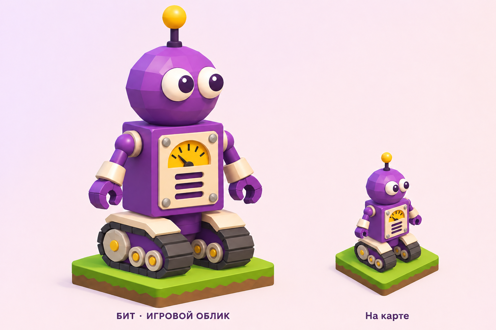
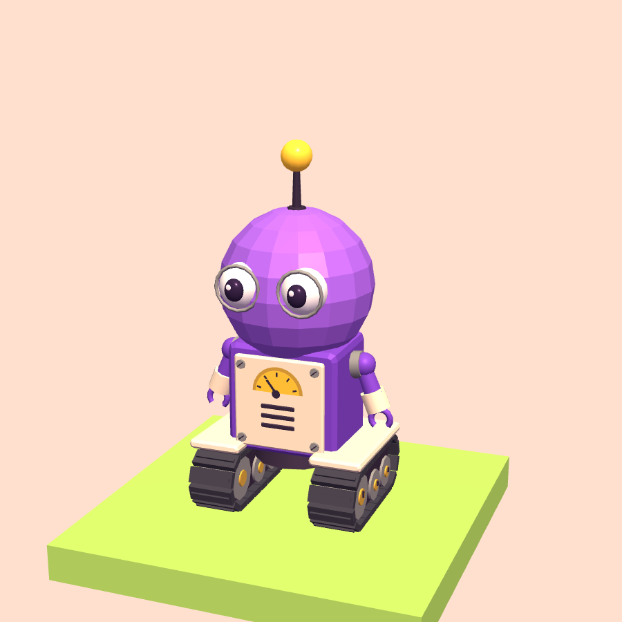

# Бит на гусеницах

Обновлённая базовая модель Бита по утверждённому рисунку. Это прежний
персонаж `bit`: его путь, код, звёзды, покупки и выбранные вещи сохраняются.

## Модель в игре

Прямоугольный фиолетовый корпус с плоскими гранями и небольшой фаской.
На кремовой панели — янтарный полукруглый прибор со стрелкой, три прорези
и четыре винта. Голова — гранёный шар, глаза белые с тёмными зрачками,
на антенне — жёлтая лампа. По бокам короткие руки с манжетами и захватами.
Две гусеницы под кремовыми крыльями: по 20 звеньев с рёбрами и три колеса
разного размера. Голова и металлические детали имеют мягкие блики.

Процедурная геометрия Three.js r128, без внешних моделей и текстур:
5823 треугольника. Проверка 240 поз с запасом на пружину удерживает
базовую модель в радиусе 0.364 клетки при допустимых 0.5.
Геометрия звеньев общая внутри модели; материалы разных портретов независимы.

## Анимации и звук

| Событие | Поведение |
|---|---|
| Покой | Моргание, взгляд, лёгкое движение рук; гусеницы стоят |
| Движение | Обе ленты и колёса вращаются пропорционально пройденному пути; корпус едет по земле |
| Поворот | Левая и правая гусеницы вращаются в противоположных направлениях |
| Проверка датчика | Отклоняется стрелка прибора, слегка двигаются руки |
| Монета, замок, рычаг | Короткое движение захватов |
| Прыжок | Общая траектория игры, небольшая пружина при приземлении |
| Победа | Радостные глаза, приподнятые руки и общий победный подскок |
| Ошибка | Грустное выражение и отклонение стрелки |

На льду герой скользит с неподвижными лентами. Привод зависит от расстояния,
поэтому скорость программы и частота кадров не меняют вращение на одну клетку.
При уменьшении движения в настройках системы отключены декоративные
движения рук и пружина. Сохранены общие звуки Бита и кнопка выключения звука.

## Интеграция

`js/bit.js` экспортирует `HeroBit.build/update/advance/reset/soundFor`.
Общая фабрика `buildHeroParts` в `app.js` использует эту модель для мира,
выбора персонажа, страницы героя, общей ссылки, итога пролога, грамот,
режима показа `?show` и восьми рекламных кадров `?shots`.
Отсутствующий или неизвестный облик также разрешается в Бита.

Координаты головы сохранены для прежнего снаряжения. Биту доступны все
существующие вещи; цвет меняет корпус и голову, головной убор скрывает
антенну. Система путей и формат localStorage не меняются.
Узлы анимации хранятся в WeakMap отдельно для каждой копии;
`reset(hero)` вызывается при смене модели в общей группе.

## Проверка

`node tests/check-bit.js`: клетка, бюджет геометрии, прямой ход,
встречное вращение, остановка, независимость от числа кадров, клоны,
сброс узлов, уменьшение движения, совместимость вещей и порядок скриптов.

В браузере проверять прохождение пролога и задания с датчиками,
снаряжение из старого сохранения, все портреты и экспорт, верхнюю камеру,
телефон и лёгкую графику. Изображение выше — рендер самой модели;
концепт служит художественным ориентиром.
