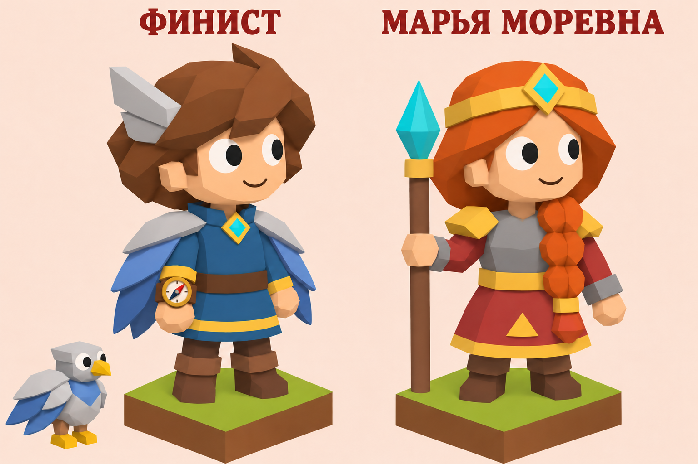
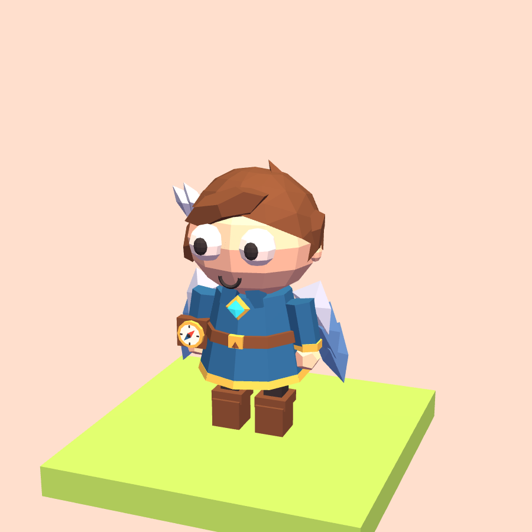
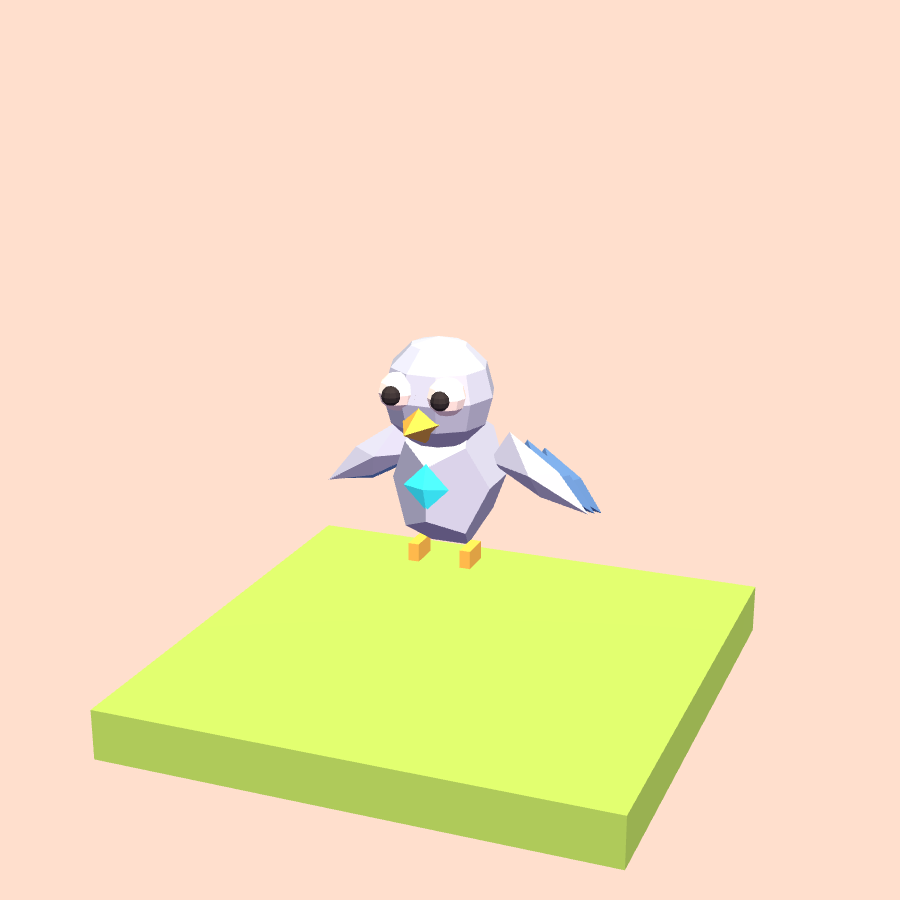

# Финист Ясный Сокол

Игровой персонаж, доступный бесплатно на экране выбора после заставки.
Первый выбор начинает отдельный путь с нуля; повторный продолжает его.
Марья Моревна на общем концепте остаётся кандидатом, в игру не добавлена.

## Игровая модель

Гранёные каштановые волосы, простое лицо, синяя туника с золотистой каймой,
коричневые пояс и сапоги, бирюзовая застёжка. На каждой стороне плаща —
три крупных металлических пера. На запястье — круглый компас: светлый
циферблат, четыре риски, красная и синяя половины стрелки.
Стрелка компенсирует поворот героя; при проверке датчика слегка качается.
Это декоративный прибор, дополнительных команд для него нет.

Модель процедурная, на Three.js r128, без загрузки текстур и 3D-файлов.
Все формы компактны: проверка вершин 280 поз, включая полёт, шаги и
пружину приземления, удерживает силуэт в радиусе 0.5 клетки.

## Анимации

| Событие | Поведение |
|---|---|
| Покой | Улыбка, моргание, взгляд и лёгкое покачивание перьев |
| Шаг/поворот | Общие шаги игры; перья следуют движению, стрелка меняет положение |
| Проверка датчика | Приподнимает руку с компасом, стрелка отклоняется и возвращается |
| Прыжок | В воздухе принимает форму механического сокола и машет короткими крыльями |
| Приземление/остановка | Снова человеческий облик; переход не зависит от таймера |
| Победа | Улыбка, радостные глаза и движение крыльев плаща |
| Ошибка | Грустный рот и общий взгляд вниз |

Сокол — форма того же героя, а не отдельный питомец. Траектория, допустимая
дальность прыжка и проверки препятствий остаются общими для всех персонажей.
Форма определяется фактическим подъёмом героя в событии `jump`, поэтому
ускорение, остановка программы и переход к другому заданию не оставляют его
птицей. В портретах используется человеческая форма.

При `prefers-reduced-motion` остаётся человеческая форма, отключены
декоративные махи и движение руки. Обычное перемещение по карте работает.

## Звук

Пять коротких сигналов синтезируются Web Audio через общий `Sound`:

- `finistHello`: двухчастный свист при входе в путь;
- `finistFlight`: мягкий шелест и восходящий свист при прыжке;
- `finistCompass`: два тихих тона при проверке датчика;
- `finistWin`: светлое арпеджио при победе;
- `finistFail`: короткий нисходящий отклик при ошибке.

Работают общий mute и ограничение частоты повторов. Нет непрерывного
звука в покое и звука в портретах. После переключения пути с перезагрузкой
приветствие звучит при первом действии пользователя, разрешающем Web Audio.

## Сохранение и вещи

`save.gear.skin = 'finist'`, существующий ключ localStorage не меняется.
Архивы пяти прежних героев сохраняются. См. [отдельные пути](journeys.md).
Фиксированы туника, застёжка, компас и плащ-крылья. Допускаются предметы
слотов `head`, `face`, `pet`; несовместимые вещи отключены в лавке и снаряжении.
Во время превращения надетые шапка и очки временно скрыты и возвращаются
после приземления. Покупки и выбранные вещи не удаляются.

`js/finist.js` экспортирует `build`, `update`, `reset`, `soundFor`.
Общие события для Финиста и изобретательницы передаёт `characterEvent` в
`app.js`. Копии модели имеют собственные узлы анимации в WeakMap; сброс
кэша обязателен при переиспользовании группы `hero`.

## Проверка

`node tests/check-finist.js` — геометрия, две формы, компас, уменьшение
движения, независимость клонов, совместимость снаряжения и наличие звуков.
`node tests/check-journeys.js` — в том числе добавление Финиста к прежним
сохранениям. `node tests/check-inventor.js` и `node tests/check-story.js` —
совместимость общей интеграции и звуков.

В браузере проверять начало нового пути, возврат к прежнему, шаги, повороты,
монеты, полёт на прыжке и возврат после него, датчики, победу/ошибку,
реальный синтез пяти звуков и mute, общий портрет, телефон и лёгкую графику.
