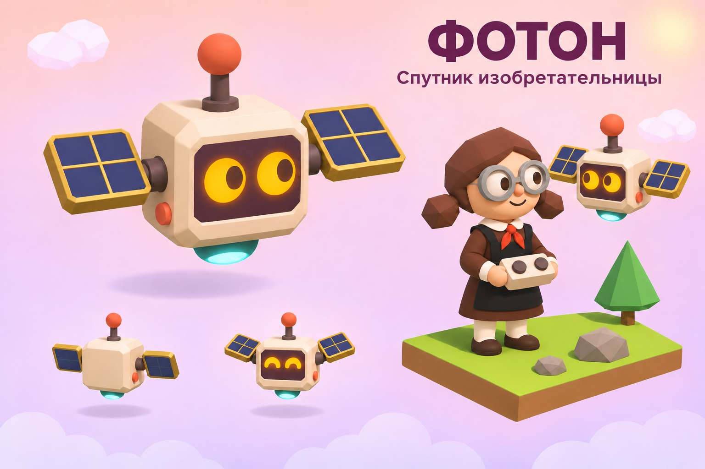
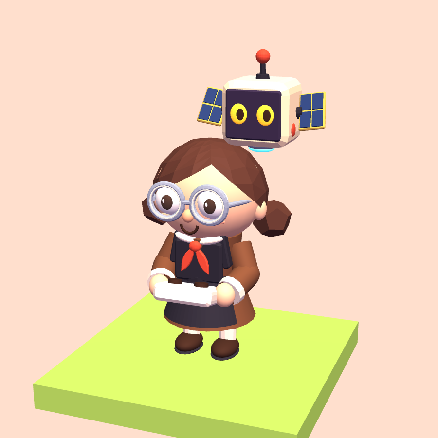

# Изобретательница и спутник «Фотон»

Утверждённый образ: юная изобретательница в советской школьной форме,
с пультом и летающим спутником с короткими солнечными панелями.
Доступна бесплатно на **экране выбора персонажа после заставки**.
Сменить героя в игре: **страница героя → Снаряжение → персонаж**.
Первый выбор создаёт отдельный путь с нуля, повторный продолжает его.



Игровая модель в графике проекта:



## Внешний вид

- Коричневое платье до колен, чёрный фартук, белые воротник и манжеты,
  светлые чулки, тёмные туфли, красный пионерский галстук.
- Округлое лицо с носом, спокойной улыбкой и бликами в глазах. Волосы
  гранёные, с боковым пробором и двумя короткими косичками. Круглые
  защитные очки имеют оправу, дужки и прозрачные линзы.
- Платье с отдельным лифом и расширяющейся юбкой; у фартука есть нагрудник,
  лямки, пояс и бант сзади. Из-под подола видны чулки и округлые туфли.
  Согнутые руки с манжетами держат скруглённый пульт с двумя кнопками.
- «Фотон»: кремовый корпус с фасками, тёмный экран с двумя янтарными глазами
  и тёмными зрачками,
  красная антенна, бирюзовое сопло, две короткие синие солнечные панели
  с золотистой рамкой и четырьмя секциями на каждой. Панели наклонены
  вперёд: их ячейки читаются и на маленьком портрете.
- Сохраняется увеличенный вариант спутника: корпус 0.25 единицы против
  ширины головы 0.42; полный размах панелей около 0.473. Модель собрана
  средствами Three.js r128: гладкие объёмы лица и рук, гранёные волосы,
  фаски и небольшие детали. Освещение остаётся игровым; иллюстрация
  служит референсом формы и пропорций.

## Поведение и анимации

| Событие | Изобретательница | «Фотон» |
|---|---|---|
| Покой | Спокойная улыбка, моргание, взгляд на цель и камеру | Лёгкое парение у плеча, моргание |
| Шаг и поворот | Общие шаги, взгляд перед поворотом; пульт слегка движется | Наклон корпуса и поднятые панели |
| Прыжок | Поджимает ноги, пружинит при приземлении | Следует вместе с героиней, панели складываются |
| Проверка датчика | Смотрит в направлении проверки, слегка наклоняет пульт | Короткий кивок и двойной радиосигнал |
| Монета | Общая реакция на находку | На короткое время счастливые глаза |
| Победа | Радость, общий победный поворот | Глаза-дуги, приподнимается, машет панелями |
| Ошибка | Грустный взгляд, общая реакция на препятствие | Опускается, панели поникают, мягкий нисходящий сигнал |

Спутник встроен в облик: у него нет собственной клетки, столкновений,
команд, звёзд или отдельного маршрута. Он движется вместе с героиней;
не летает широкими кругами и не собирает монеты самостоятельно.
Проверка геометрии охватывает 240 поз и запас на пружину приземления:
все вершины базового образа остаются в радиусе 0.5 относительно центра
клетки, поэтому поворот не расширяет занимаемую область. Надетые
дополнительные шляпы и вещи на спину проверяются отдельно визуально.

При `prefers-reduced-motion` отключены декоративное покачивание, кивки,
моргание спутника и движения панелей; состояния глаз по-прежнему
показывают результат. Функциональное перемещение героя остаётся.
Режим «Лёгкая графика» использует ту же модель без новых источников света.

## Звук

Четыре коротких сигнала синтезируются Web Audio, без аудиофайлов и сети:

- `photonHello` — восходящий сигнал при входе в путь (после перезагрузки — при первом действии);
- `photonScan` — тихая двойная проверка датчика, не чаще раза в 0.35 с;
- `photonWin` — короткое победное арпеджио;
- `photonFail` — спокойный нисходящий сигнал при ошибке.

Нет постоянного гула двигателя и звуков в портретах/примерке.
Сигналы используют общий `Sound.muted`, запускаются только после
разрешённого браузером пользовательского действия и не заменяют
существующую звуковую обратную связь задания.

## Сохранения и снаряжение

Облик записывается как `save.gear.skin = 'inventor'` в существующее
хранилище `mir-geroya-usloviya-v1`. У каждого персонажа собственный
прогресс курса; переключение архивирует прежний путь и открывает
выбранный. [Формат сохранения и миграция](journeys.md).
Очки, галстук, цвет школьной формы и спутник составляют образ; слоты
`face`, `neck`, `color`, `pet` для неё недоступны. Прежние значения
в импортированном сохранении не удаляются; у других персонажей
свои наборы вещей в их отдельных путях.
Головные уборы и вещи на спину доступны. Лавка не продаёт для этого
образа несовместимые вещи, которые невозможно примерить.

Облик поддерживается в мире, на острове героя, в ссылке «Поделиться»,
портрете пролога и на грамоте. Портреты собирают собственную модель:
анимации спутника в них не меняют основного героя.

## Код и проверка

- `js/inventor.js` — модель, анимации спутника и пульта, выбор сигналов.
- `js/gear.js` — облик и `fitsSkin`, единая совместимость снаряжения.
- `js/app.js` — общая мимика/перемещение, события и интерфейс выбора.
- `js/sound.js` — синтез сигналов, ограничение частоты и общая громкость.

Из корня проекта:

```sh
node tests/check-inventor.js
node tests/check-journeys.js
node tests/check-tasks.js
node tests/check-story.js
node tests/check-trial.js
node tests/check-bridge.js
```

При изменениях проверить в браузере выбор и сохранение облика, обычную
и верхнюю камеру, шаг/поворот/прыжок, монеты, победу и ошибку, выключение
звука, остров героя, ссылку и режим уменьшения движения. Изменение
анимаций не должно влиять на результаты учебных программ.
