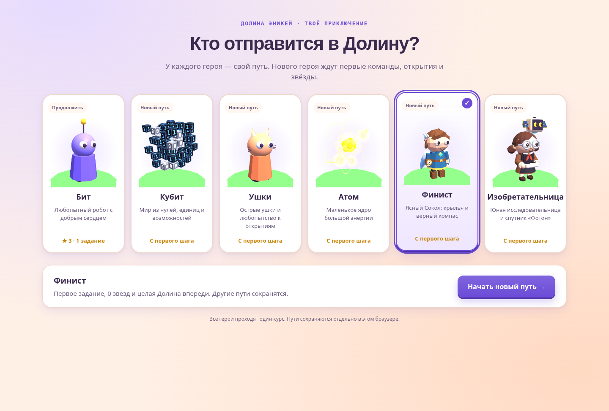

# Выбор персонажа и отдельные пути



После нажатия клавиши или касания заставки открывается экран с шестью
3D-портретами: Бит, Кубит, Ушки, Атом, Финист, Изобретательница с «Фотоном».
На каждой карточке показаны описание, наличие пути, звёзды и решённые
задания. Портреты рисуются настоящими моделями проекта; внешние картинки
или сеть для экрана не нужны. Шесть портретов рисуются одним временным
WebGL-рендерером, после чего остаются обычные canvas; повторное открытие
экрана использует кэш и не создаёт новые 3D-сцены.

- Нажатие карточки выбирает героя для просмотра. Сохранения ещё не меняются.
- **Начать новый путь** создаёт чистый прогресс персонажа: пролог, первое
  задание, 0 звёзд, без прежнего кода, подсказок, покупок и достижений.
- **Продолжить путь** возвращает его урок, задание, код и накопленный прогресс.
- Остальные пути сохраняются. Автоматического удаления или общего сброса нет.
- В игре персонажа можно сменить через страницу героя → Снаряжение.
  Этот выбор тоже открывает экран путей, а не переносит звёзды другому герою.
- Громкость, лёгкая графика и крупный шрифт переносятся как настройки
  доступности. Учебные результаты и личное снаряжение не переносятся.

На стартовом экране клавиатура: стрелки/Home/End выбирают карточку,
Tab переводит фокус на кнопку действия, Enter/Пробел нажимают кнопку.
Фокус остаётся внутри диалога; игровая область временно `inert`.
При смене героя из игры Escape или «Вернуться в игру» отменяют выбор.
На телефоне карточки перестраиваются в две колонки. Поддержаны тёмная
тема и уменьшение движения.

## Сохранения

Ключ `mir-geroya-usloviya-v1` сохраняется. В верхнем уровне JSON по-прежнему
находится прогресс активного пути, поэтому существующий игровой код
читает прежние поля `stars`, `code`, `gear`, `seen` и остальные.
Добавлено поле:

```js
journeyState: {
  version: 1,
  active: 'inventor',
  paths: {
    bit: { /* полный прежний путь, без вложенного journeyState */ }
  }
}
```

В архиве лежат только неактивные пути; активный хранится сверху.
Старое сохранение без `journeyState` приписывается его выбранному
облику (или Биту по умолчанию). Старый `pixel` соответствует `qubit`.
Первая миграция не удаляет прогресс, вещи и другие известные/добавленные поля.

`HeroJourneys.select` сохраняет архив и новый активный путь одной записью
`localStorage.setItem`. При отказе записи переключения нет; пользователь
видит сообщение. Повреждённый JSON не перезаписывается чистым сохранением.
Вторая вкладка, оставшаяся в прежнем пути, обновляет его архив и не
перезаписывает активного героя другой вкладки. Одновременная игра в одном
и том же пути в двух вкладках использует последнее сохранение; слияния
отдельных правок внутри одного пути нет.

После переключения страница перезагружается, чтобы сбросить незавершённые
прогоны, сцены, разминки и кэш заданий. Одноразовая отметка
`sessionStorage['mir-geroya-enter-journey']` пропускает повторную заставку.
Если sessionStorage недоступен, путь всё равно сохранён, но заставка
показывается повторно.

Домашка и свой уровень из входящей ссылки открываются и после стартового
выбора другого героя. Ссылки на страницу героя и результат испытания
сначала показывают просмотр, не требуют выбора и не подменяют личный путь.
Режимы `?show` и `?shots` пропускают выбор и не записывают прогресс.

## Проверки

```sh
node tests/check-journeys.js
node tests/check-inventor.js
node tests/check-story.js
```

При изменении переходов дополнительно проверить в браузере: старое
сохранение → новый герой с нуля → решение задания → возврат к прежнему
герою → продолжение нового пути после перезагрузки. Также клавиатуру,
телефон, тёмную тему, входящую домашку, общие ссылки и демонстрационный режим.
